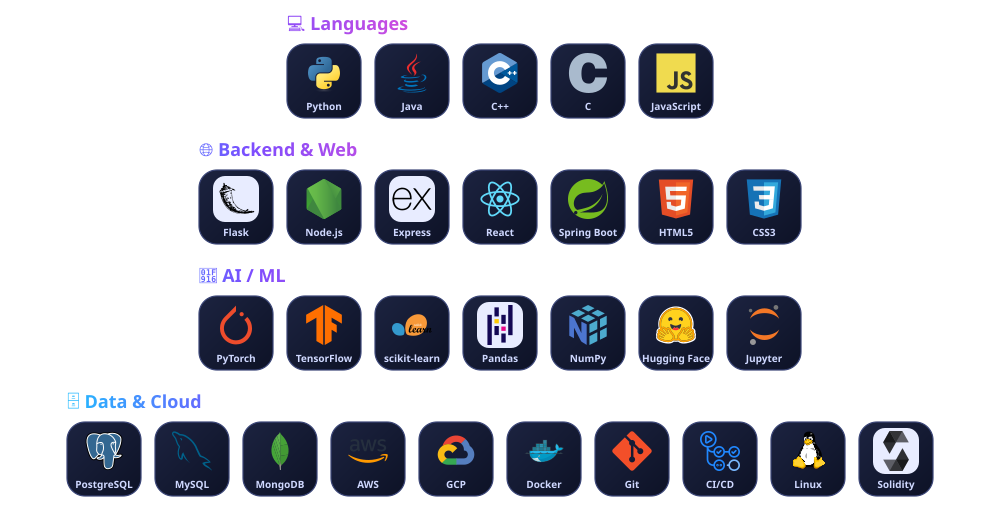
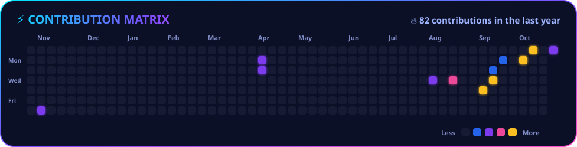

  

  

  
  
  

  
  
  
  

- 🎓 Final-year **B.Tech CSE** at **VIT Chennai** (CGPA **8.93**) and **BS Data Science** at **IIT Madras** (CGPA **9.02**)
- 🤖 I build **LLM-powered and full-stack applications** in Python, Java, Flask, Node.js and React
- 🛡️ **Cyber Defence intern at Deloitte**: VAPT, OWASP Top 10, threat analysis
- 📄 **Patent published** (Appl. No. 202641002269): real-time driver posture and fatigue monitoring
- 🏆 Team lead at **Deloitte Hacksplosion 2026**, a national GenAI hackathon (advanced to the pre-final round)
- 🎯 Looking for **Software Engineer / AI Engineer** roles as a 2027 graduate

<table align="center">
  <tr>
    <td align="center"><h3>🎯 8.93</h3>CGPA, VIT</td>
    <td align="center"><h3>📚 9.02</h3>CGPA, IIT Madras</td>
    <td align="center"><h3>🛡️ 400+</h3>Vulnerabilities documented</td>
    <td align="center"><h3>🩺 10,000+</h3>Records modeled</td>
    <td align="center"><h3>📄 1</h3>Patent published</td>
  </tr>
</table>

<table>
  <tr>
    <td width="50%" valign="top">
      <h3>💸 Micro-SMB Finance AI Copilot</h3>
      Text, snap or speak a transaction in <b>Telegram</b> and get a clean ledger back. LLM parsing, receipt OCR, web dashboard, deployed on Render.  
      
      
      
        
      <a href="https://github.com/karthikesh15/Finance-Copilot">📂 Code</a> &nbsp;|&nbsp; <a href="https://drive.google.com/file/d/1O3E0eTrIaJX_uu6m1KRxa7Eyu10lyJnH/view?usp=sharing">▶️ Demo</a>
    </td>
    <td width="50%" valign="top">
      <h3>🩺 Chronixa</h3>
      Explainable chronic disease risk prediction (diabetes, hypertension and more) on <b>10,000+ records</b>, with XGBoost and SHAP explanations.  
      
      
      
        
      <a href="https://github.com/karthikesh15/Chronixa">📂 Code</a>
    </td>
  </tr>
  <tr>
    <td width="50%" valign="top">
      <h3>🅿️ ParkPal</h3>
      Parking slot booking platform with separate <b>user and admin</b> workflows for locations, slots, bookings and queries.  
      
      
        
      <a href="https://github.com/karthikesh15/ParkPal">📂 Code</a>
    </td>
    <td width="50%" valign="top">
      <h3>🔗 BlockProof</h3>
      Tamper-proof file integrity on <b>Ethereum (Sepolia)</b>. Hash a file with keccak256, anchor it on-chain, verify it later.  
      
      
        
      <a href="https://github.com/karthikesh15/BlockProof">📂 Code</a>
    </td>
  </tr>
  <tr>
    <td colspan="2" valign="top">
      <h3>🎫 AI Auto-Ticket Categorization (Deloitte Hacksplosion 2026)</h3>
      Led <b>Team NeuroForge</b> (4 members) to the nationwide pre-final round with an AI-powered ticket categorization prototype built on Deloitte's GenW.AI platform.
      
      
      
    </td>
  </tr>
</table>

<b>🛡️ Cyber Defence and Resilience Intern, Deloitte India</b> &nbsp;|&nbsp; Jun 2026 - Present

- Documented **400+ vulnerabilities** as part of Vulnerability Assessment and Penetration Testing (VAPT) work, with hands-on exposure to Burp Suite and Nmap.
- Conducted threat analysis and recommended remediation strategies aligned with OWASP Top 10 and industry best practices.

<b>🔬 Research Intern, CeHMA, VIT Chennai</b> &nbsp;|&nbsp; May 2025 - Jul 2025

- Co-developed a patent-published concept for real-time driver posture and fatigue monitoring using camera modules, sensors and ML-based detection (Appl. No. 202641002269).
- Defined a fatigue index and posture risk score; analyzed prior patents and ergonomic research to establish novelty and prepared technical documentation for filing.

  

  
  
  
  
  
  

- 🥇 **The Code Gambit, Kratos'24**: 1st place out of 30+ teams (SRM Easwari, national-level contest)
- 🥉 **Code Golf, TechnoVIT'25**: 3rd place (VIT Chennai)
- 🚀 **Deloitte Hacksplosion 2026**: team lead, advanced to the pre-final round of a national GenAI hackathon
- 🩺 **HackWell Hackathon (WellDoc)**: Top 25 of 150+ teams, led Team ClinXplain
- 📐 **NPTEL Linear Algebra**: Elite + Silver Medal (IIT Madras); 8 Topper badges in IITM BS Data Science
- 📄 **Patent published**: Appl. No. 202641002269

| 🎓 Degree | 🏫 Institution | 📅 Period | ⭐ CGPA |
|---|---|---|---|
| B.Tech, Computer Science and Engineering | Vellore Institute of Technology, Chennai | 2023 - 2027 | **8.93** |
| BS, Data Science and Applications (Online) | IIT Madras | 2025 - 2028 | **9.02** |

<!--

  

-->

  

  
  

  
  
  

<b>Open to 2027 graduate roles in Software Engineering and AI. Let's build something great together. 🚀</b>

